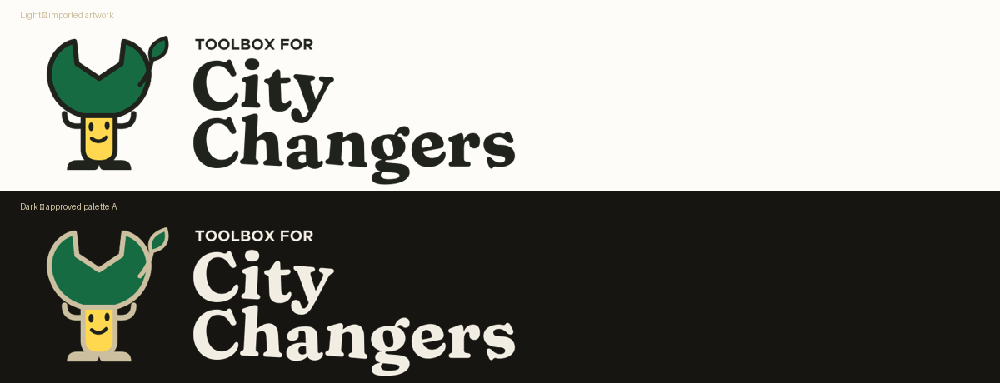
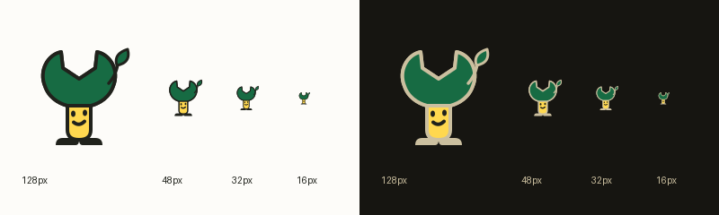

# Current design

Only the identity used by the live site belongs here: **The Green Fix** mascot
with the approved, user-edited Fraunces wordmark. Dropped concepts, iterations,
palette options and old asset backups have been removed.

## Logo — light and dark



## Browser icon



These proofs are rendered from the actual production assets, not concept files.
See [the identity notes](logo/ACTIVE.md) for masters and integration details.

## Tooling

- `logo/`: approved source artwork and current proofs only.
- `scripts/build-brand-assets.py`: regenerate production exports from the active masters.
- `scripts/verify-logo-import.py`: verify the approved source and refresh the proofs and asset hashes.
- `tests/`: identity and front-matter regression checks.

From the repo root:

```sh
python3 design/scripts/build-brand-assets.py
python3 design/scripts/verify-logo-import.py
python3 -m unittest discover -s design/tests -v
```

Image tooling requires CairoSVG and Pillow; front-matter checks also use the
handbook Python dependencies. This folder and the production assets in
`src/assets/site/` and `public/` are versioned; normal site/download builds
do not depend on this folder. Python bytecode caches remain ignored.
